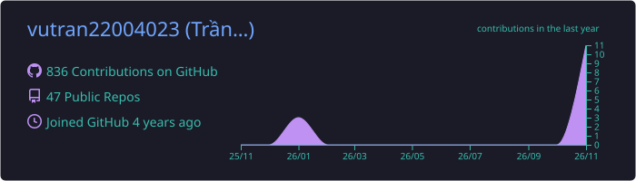
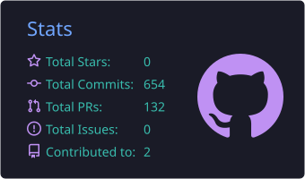
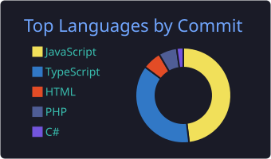
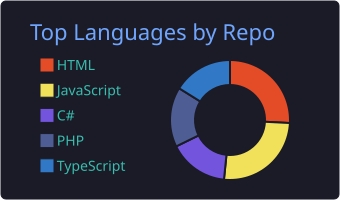
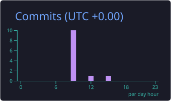

# Hi there, I'm Trần Lê Vũ 👋
### 🚀 Full Stack Developer (Mobile & Backend) | Edge AI & Real-time Systems

  
  
  
  

  
  

---

  

  <b>🌐 Select Language / Chọn ngôn ngữ:</b> 
  <a href="#-tiếng-việt-phiên-bản-chính">🇻🇳 <b>Tiếng Việt</b></a> •
  <a href="#-english-version">🇬🇧 <b>English Version</b></a> •
  <a href="#-links--downloads--liên-kết--tải-xuống">🔗 <b>Links & Downloads</b></a> •
  <a href="#-get-in-touch--liên-hệ">📫 <b>Contact</b></a>

---

## 🛠️ Tech Stack & Skills

### 💻 Programming Languages

### 📱 Frontend, Mobile & Desktop

### ⚙️ Backend, AI & Real-Time Protocols

### 🏗️ Architecture

### 🗄️ Databases & DevOps

### 🤖 AI-Assisted Development

---

# 🇻🇳 TIẾNG VIỆT (PHIÊN BẢN CHÍNH)

## 🌟 Giới thiệu bản thân

- 💼 **Full Stack Developer** với hơn **2 năm kinh nghiệm** thực chiến phát triển các giải pháp đa nền tảng (**Mobile iOS/Android**, **Web**, **Desktop Kiosk** và **Backend**).
- 🧠 Chuyên sâu xây dựng **Edge AI & IoT Systems**: Nhận diện khuôn mặt với Frigate NVR, trích xuất Face Embeddings, stream WebRTC độ trễ thấp qua go2rtc và Kiosk chấm công rảnh tay.
- ⚡ Có kinh nghiệm giải quyết các bài toán nghiệp vụ phức tạp: Động cơ tính công & phân ca đa tầng (.NET 8), chat nội bộ thời gian thực (Local Cache, Thread, Infinite Scroll) và quy trình tự động hóa **CI/CD / OTA Hot-update**.
- 🎓 Tốt nghiệp **Kỹ sư Phần mềm** tại **VTC Academy Đà Nẵng** (GPA: **[83.12](https://drive.google.com/file/d/1_fK4kMpmLyoK-MYh43mAWIxb49NlOyTi/view?usp=sharing)**).
- 🎯 Định hướng: phát triển chuyên sâu **.NET Backend** (kiến trúc phần mềm, tối ưu cơ sở dữ liệu, khả năng mở rộng hệ thống) và ứng dụng **AI / AI Agent** vào quy trình phát triển.

## 💼 Kinh nghiệm làm việc

### 🏢 **Công ty TNHH Quản trị số Fastdo** | *Lập trình viên Full Stack (Mobile & Backend)*
> `08/2025 – Hiện tại` | *Hệ sinh thái Fastdo: Quản trị doanh nghiệp HRM, Chấm công thông minh, Task Management & Chat nội bộ*

- **Hệ thống Chấm công AI Camera & Desktop Kiosk:**
  - Thiết kế và triển khai giải pháp chấm công khuôn mặt bằng **AI Camera**, tích hợp **Frigate NVR** và **Face Embeddings**, tự động quét tìm camera qua đa lớp mạng LAN / router phụ.
  - Xây dựng ứng dụng **Desktop Kiosk** (React Native Web + Vite + Electron), kết nối camera qua **WebRTC** độ trễ cực thấp với **go2rtc** cho phép tự chấm công rảnh tay.
- **Động cơ Nghiệp vụ Chấm công & Phê duyệt Phức tạp:**
  - Xây dựng hệ thống tính công lõi trên **.NET 8 & React Native**: xử lý ca đêm qua ngày, ca liền kề, tự động bù giờ OT vào ca chính, chống gian lận vị trí với **FaceID, GPS Geofencing và Wi-Fi BSSID**.
  - Xây dựng cơ chế chấm công hộ, phê duyệt đơn từ động đa cấp (tự động gộp bước duyệt, phân quyền linh hoạt theo sơ đồ tổ chức).
  - Xây dựng và tối ưu **RESTful API với ASP.NET Core** theo **Clean Architecture & Dependency Injection**.
- **Trải nghiệm Mobile & Chat Thời gian thực:**
  - Tích hợp **iOS Live Activities & Android Widgets** hiển thị ca làm và nhắc nhở chấm công theo thời gian thực.
  - Tối ưu hóa hệ thống chat (**fChat**) với **SignalR**, SQLite Local Cache, Infinite Scrolling, Reaction, Thread và Sticker Keyboard.
  - Xây dựng pipeline **OTA Hot-Update (CodePush/CI-CD)** qua GitHub Actions với quy trình duyệt Beta & tự động Rollback khi phát hiện crash.

> 📲 **Tải ứng dụng:** [App Store](https://apps.apple.com/vn/app/fastdo-app/id6749427979) • [Google Play](https://play.google.com/store/apps/details?id=com.fastdonative)

### 🏢 **Công ty [SapotaCorp](https://www.sapotacorp.vn)** | *Lập trình viên Full Stack (Mobile & Backend)*
> `06/2024 – 06/2025` | *Dự án: [SheetMuse](https://sheetmuse.app/) – Music Learning & Band Rehearsal Platform*

- Nền tảng học nhạc và luyện tập âm nhạc đa nền tảng (**iOS, Android, Web**).
- Phát triển tính năng hiển thị bản nhạc, hợp âm, lời bài hát và tách âm thanh thành từng nhạc cụ (**Audio Stems**).
- Trình phát nhạc nâng cao (tùy chỉnh tốc độ, cao độ, lặp đoạn nhạc) phục vụ việc luyện tập cá nhân.
- Xây dựng tính năng **BandSync**: cho phép nhiều người dùng cùng tham gia buổi tập và đồng bộ trạng thái phát nhạc thời gian thực qua **WebSocket & Node.js**.
- Tech: React Native, Expo, TypeScript, Swift, Kotlin, Node.js, WebSocket.

> 🌐 **Website:** [sheetmuse.app](https://sheetmuse.app/) • 📄 **Thư giới thiệu:** [SapotaCorp](https://drive.google.com/file/d/1hhpTF4XUcgkE_HmXkGuZRcoXpJXcS-F5/view)

## 🎓 Học vấn

| Trường | Chuyên ngành | Thời gian | Kết quả |
|---|---|---|---|
| **VTC Academy Đà Nẵng** | Kỹ sư Phần mềm (Software Engineering) | 2022 – 2025 | GPA: [**83.12**](https://drive.google.com/file/d/1_fK4kMpmLyoK-MYh43mAWIxb49NlOyTi/view?usp=sharing) |

## 🤝 Kỹ năng mềm

`Tư duy phân tích & giải quyết vấn đề` · `Làm việc nhóm & phối hợp liên chức năng` · `Chủ động học công nghệ mới` · `Quản lý thời gian & ưu tiên công việc` · `Tư duy logic & phản biện kỹ thuật` · `Thích nghi & trách nhiệm`

---

# 🇬🇧 ENGLISH VERSION

## 🌟 Professional Summary

- 💼 **Full Stack Software Engineer** with over **2 years of hands-on experience** developing high-performance multi-platform solutions across **Mobile (iOS/Android)**, **Web**, **Desktop Kiosks**, and **Enterprise Backend**.
- 🧠 Deep focus on **Edge AI & IoT Systems**: Face recognition integration (Frigate NVR, Face Embeddings), ultra-low latency WebRTC streaming via go2rtc, and contactless smart attendance kiosks.
- ⚡ Proven track record in solving complex architectural challenges: multi-tenant shift calculation engines (.NET 8), enterprise real-time messaging (Local DB Caching, Threading, Infinite Scroll), and automated **OTA Hot-update CI/CD pipelines**.
- 🎓 Graduated as a **Software Engineer** from **VTC Academy Da Nang** (GPA: **[83.12](https://drive.google.com/file/d/1_fK4kMpmLyoK-MYh43mAWIxb49NlOyTi/view?usp=sharing)**).
- 🎯 Career goal: growing into a **Senior .NET Backend Developer** (software architecture, database optimization, scalability) while applying **AI / AI Agents** to the development workflow.

## 💼 Work Experience

### 🏢 **Fastdo Digital Management Co., Ltd.** | *Full Stack Developer (Mobile & Backend)*
> `08/2025 – Present` | *Fastdo Ecosystem: Enterprise HRM, Smart Attendance, Todolist & Internal Chat*

- **Edge AI Smart Attendance & Kiosk Systems:**
  - Architected an automated face-recognition attendance system integrating **Frigate NVR** and centralized **Face Embeddings**, capable of auto-discovering IP cameras across complex LAN subnets.
  - Engineered a standalone **Desktop Kiosk** application (React Native Web + Vite + Electron) with ultra-low latency **WebRTC / go2rtc** streaming for seamless contactless check-in.
- **Complex Attendance & Multi-tiered Approval Engine:**
  - Designed core calculation services on **.NET 8 & React Native**: handled intricate overnight shifts, adjacent overtime (OT), automated attendance-leave-shift compensation, and check-in on behalf of colleagues.
  - Integrated multi-factor anti-fraud validation with **Face Authentication, GPS Geofencing, and Wi-Fi BSSID**.
  - Built and optimized **RESTful APIs with ASP.NET Core** following **Clean Architecture & Dependency Injection**.
- **Mobile Experience & Real-Time Collaboration:**
  - Implemented **iOS Live Activities & Android Home Widgets** delivering real-time shift status and proactive check-in reminders.
  - Optimized **fChat** performance using **SignalR**, SQLite Local Cache, infinite scrolling, message threading, reactions, and customizable sticker keyboards.
  - Built an automated **Over-The-Air (OTA) Hot-Update Pipeline** via GitHub Actions with Beta approval channels and automatic crash-detection rollback.

> 📲 **Download the app:** [App Store](https://apps.apple.com/vn/app/fastdo-app/id6749427979) • [Google Play](https://play.google.com/store/apps/details?id=com.fastdonative)

### 🏢 **[SapotaCorp](https://www.sapotacorp.vn)** | *Full Stack Developer (Mobile & Backend)*
> `06/2024 – 06/2025` | *Project: [SheetMuse](https://sheetmuse.app/) – Music Learning & Band Rehearsal Platform*

- Developed a cross-platform music education ecosystem (**iOS, Android, Web**).
- Engineered interactive sheet music features displaying real-time notes, chords, lyrics, and isolated instrument audio stems (**Audio Stems separation**).
- Delivered advanced playback capabilities: pitch shifting, dynamic tempo adjustment, and A/B section looping.
- Architected **BandSync**: a real-time collaborative feature enabling multiple band members to synchronize playback states simultaneously via **Node.js & WebSocket**.
- Tech: React Native, Expo, TypeScript, Swift, Kotlin, Node.js, WebSocket.

> 🌐 **Website:** [sheetmuse.app](https://sheetmuse.app/) • 📄 **Recommendation letter:** [SapotaCorp](https://drive.google.com/file/d/1hhpTF4XUcgkE_HmXkGuZRcoXpJXcS-F5/view)

## 🎓 Education

| School | Major | Period | Result |
|---|---|---|---|
| **VTC Academy Da Nang** | Software Engineering | 2022 – 2025 | GPA: [**83.12**](https://drive.google.com/file/d/1_fK4kMpmLyoK-MYh43mAWIxb49NlOyTi/view?usp=sharing) |

## 🤝 Soft Skills

`Analytical thinking & problem solving` · `Teamwork & cross-functional collaboration` · `Proactive learning` · `Time management & prioritization` · `Logical & critical technical thinking` · `Adaptability & responsibility`

---

## 🔗 Links & Downloads / Liên kết & Tải xuống

| | Link |
|---|---|
| 📲 **Fastdo – iOS** |  |
| 🤖 **Fastdo – Android** |  |
| 🎵 **SheetMuse** |  |
| 🏢 **SapotaCorp** |  |
| 📄 **Recommendation Letter / Thư giới thiệu** |  |
| 🎓 **Transcript / Bảng điểm (GPA 83.12)** |  |
| 📥 **CV (PDF)** |  |

---

## 📊 GitHub Statistics

  
  

  
  

---

## 📫 Get In Touch / Liên hệ

**Luôn sẵn sàng trao đổi về cơ hội công việc, dự án .NET / React Native / Edge AI.**
*Always open to discussing job opportunities and .NET / React Native / Edge AI projects.*

| Kênh / Channel | Thông tin / Info |
|---|---|
| 📧 **Email** | [levu1962004@gmail.com](mailto:levu1962004@gmail.com) |
| 📞 **Phone / Zalo** | [+84 906 472 426](tel:+84906472426) |
| 💬 **Facebook** | [vu.tranle.1906](https://www.facebook.com/vu.tranle.1906/) |
| 🐙 **GitHub** | [@vutran22004023](https://github.com/vutran22004023) |

 

 

⭐️ *Profile is continuously maintained and updated with the latest works!*

